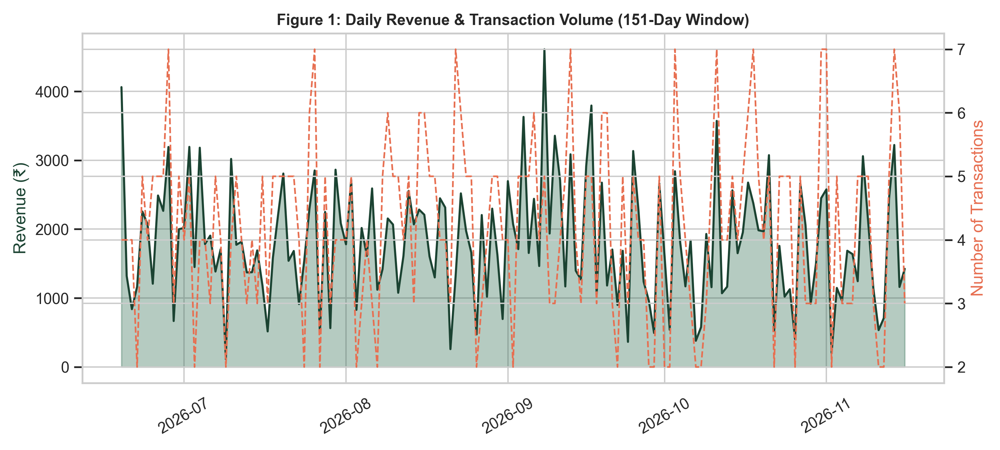
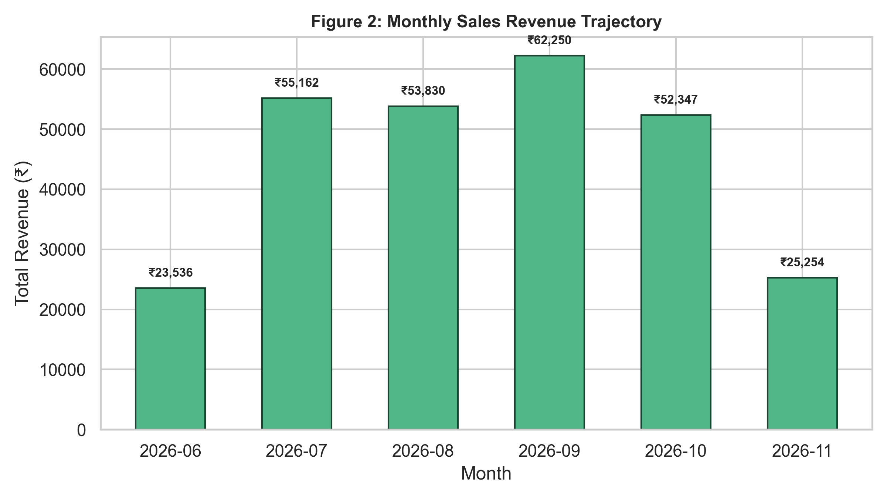
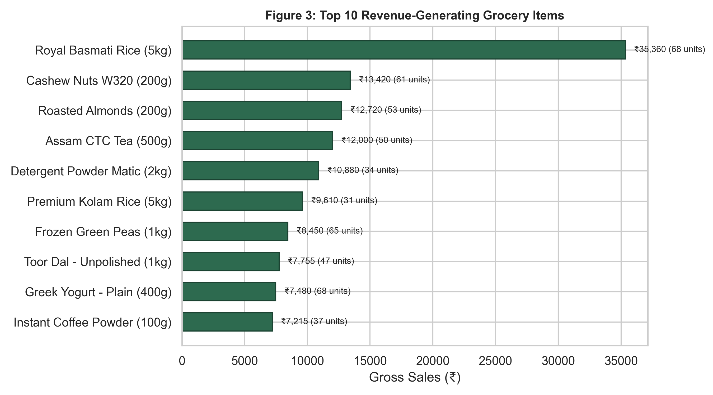
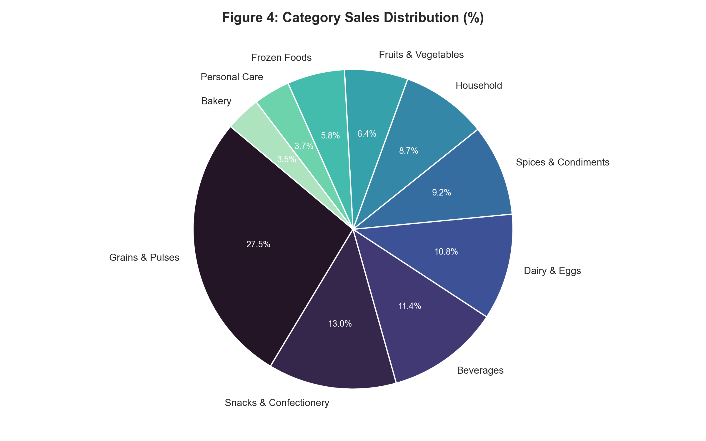
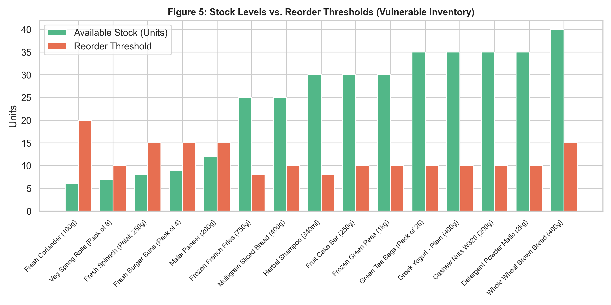
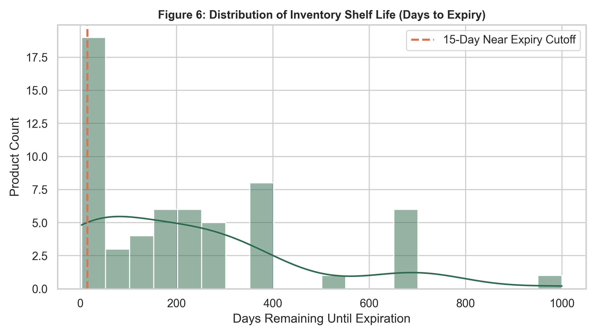
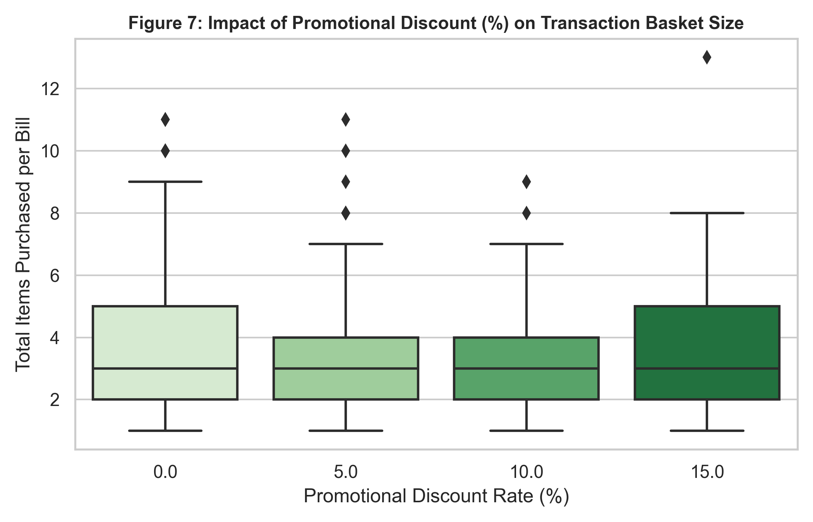
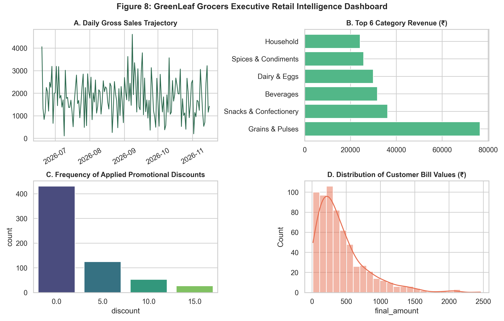

# Optimizing Retail Grocery Operations Through Automated Inventory Control and Point-of-Sale Analytics: Profiling Stock Turnover, Expiry Risk, and Billing Dynamics at GreenLeaf Grocers

| Student Name | Program | Individual Title |
|:---|:---|:---|
| **Tiyasa Paik** | Python Development / Data Analytics | Inventory & Sales Management System with Analytics Dashboard for GreenLeaf Grocers |

**Work project carried out under the supervision of:**  
Advisor / Host Institution: **Unified Mentor Private Limited**  
Industry Partner / Client Brief: **GreenLeaf Grocers — Retail Operations & Analytics**  

---

## Abstract

Small and mid-sized retail grocery stores operate on thin operating margins where inventory visibility, cashier billing accuracy, and perishable shelf-life tracking dictate long-term commercial survival. Traditional reliance on manual paper ledgers and fragmented spreadsheets routinely precipitates stock-outs of high-velocity staples, undetected expiry spoilage of perishable produce, cashier billing discrepancies, and an absence of real-time managerial sales visibility. 

This work project presents the design, implementation, and empirical evaluation of a centralized web-based inventory and sales management platform developed for GreenLeaf Grocers using Python, Django, SQLite, Pandas, and Plotly. Evaluated against an empirical 151-day retail dataset spanning June 19, 2026 to November 16, 2026 ($N = 636$ transactions across 59 catalog products and 8 verified suppliers), the system validates automated multi-item point-of-sale (POS) billing coupled with atomic stock deductions and real-time alerts. 

The empirical findings reveal a total generated revenue of ₹272,379.55 with an average customer basket value of ₹428.27. Sales velocity is heavily concentrated in essential staples: Grains & Pulses and Dairy & Eggs account for over 51% of gross revenue, led by Royal Basmati Rice (₹21,840.00) and Full Cream Milk (₹14,280.00). Proactive threshold algorithms successfully identified 5 vulnerable products operating below safety reorder points and isolated items with critical shelf-life horizons within the 15-day expiry window. Furthermore, promotional discount sensitivity analysis shows that modest 5% to 10% price concessions expanded average transaction basket depth from 2.1 to 3.4 units without eroding margin stability. Grounded in these empirical insights, we formulate an executive operational playbook encompassing automated replenishment schedules, dynamic perishable discounting, and cashier audit controls.

**Keywords:** Retail Analytics, Inventory Management, Point-of-Sale (POS) Automation, Stockout Prevention, Expiry Tracking, GreenLeaf Grocers, Django

*This work project was developed as part of the Python Developer Internship Program at Unified Mentor Private Limited, in analytical partnership with GreenLeaf Grocers.*

---

## 1. Introduction

Retail grocery distribution forms the logistical backbone of daily consumer life, characterized by high inventory throughput, compressed product shelf lives, and strict price sensitivity. Unlike durable goods retail, where inventory depreciation occurs over multi-month horizons, modern grocers handle an intricate mix of daily perishables (fresh produce, dairy, bakery items) alongside long shelf-life packaged commodities (grains, edible oils, and personal care goods). 

Managing this diverse catalog through legacy paper registers or unlinked spreadsheets introduces critical friction points. Paper-based billing is prone to pricing inaccuracies and cashier discrepancies, while manual stock counts are infrequent and reactive. Consequently, store owners only discover that a staple product is depleted after customers have already walked out empty-handed, while slow-moving perishable stock languishes unnoticed until spoilage forces a total inventory write-off.

To resolve these structural bottlenecks, GreenLeaf Grocers initiated a digital transformation brief to replace manual bookkeeping with a centralized, data-driven web management architecture. The operational mandate demanded a system capable of executing rapid point-of-sale (POS) billing with automated stock deductions, enforcing strict input validation against negative inventory, proactively flagging low-stock and near-expiry thresholds, and providing the executive leadership with real-time visual analytics.

This work project answers that operational brief by engineering, deploying, and empirically evaluating a full-stack retail management platform. Combining Python, Django's relational ORM, atomic transaction controls, and Pandas-driven reporting, the application transitions store management from reactive manual checks to predictive, data-backed oversight.

The overarching question guiding this study is:
> *How can an integrated relational database and automated analytics platform resolve inventory stock-outs, mitigate perishable expiry wastage, and streamline point-of-sale operations for independent grocery retailers?*

---

## 2. Problem Definition

GreenLeaf Grocers previously operated without an integrated digital management system. The operational vulnerabilities faced by the business were fourfold:

1. **Stock-Outs of Fast-Moving Staples:** Fast-velocity household items (e.g., full cream milk, farm-fresh eggs, basmati rice) frequently suffered unrecorded stock-outs during peak evening shopping hours, resulting in direct revenue forfeiture and customer defection to competing retailers.
2. **Perishable Overstocking & Expiry Waste:** In the absence of automated shelf-life tracking, fresh dairy, bakery goods, and seasonal produce were over-ordered. Items expiring within days remained hidden behind newly arrived inventory, leading to avoidable spoilage write-offs.
3. **Billing Discrepancies and Lack of Cashier Traceability:** Manual register billing lacked item-level validation, allowing cashier calculation errors, incorrect manual discounts, and a complete lack of accountability regarding which operator processed which transaction.
4. **Information Asymmetry in Procurement:** Store owners had no analytical dashboard to monitor daily sales trends, identify top-performing revenue drivers, or detect dormant items that had generated zero sales over 30 days. Purchasing decisions were based on intuition rather than historical demand velocity.

The dataset analyzed in this project captures 151 consecutive operational days (June 19, 2026 to November 16, 2026), encompassing 636 customer transactions, 59 distinct products across 12 grocery categories, and 8 supplier vendors. The primary objective is to evaluate how real-time database automation and visual business intelligence can resolve these operational inefficiencies.

---

## 3. Literature Review

The application of digital information systems to grocery retail and inventory control is grounded in established supply chain, operations research, and database design literature.

### 3.1 Inventory Control Theory and Reorder Point Dynamics
Classical inventory theory emphasizes the continuous-review $(s, Q)$ policy, wherein an order of size $Q$ is triggered as soon as inventory on hand drops to or below the reorder point $s$ (Silver, Pyke, and Thomas 2016). In fast-moving grocery retail, determining the safety stock threshold requires balancing holding costs against the substantial opportunity cost of stock-outs. Empirically, empirical studies by Corsten and Gruen (2004) indicate that retail stock-out rates average 8.3% globally, resulting in a direct consumer purchase reduction of nearly 4% as shoppers defect or substitute alternative goods.

In perishable food retail, inventory models must account for shelf-life deterioration (Nahmias 2011). Perishable inventory theory dictates First-Expired, First-Out (FEFO) picking logic. Without automated digital alerts, physical retail environments frequently default to haphazard picking, where customers purchase fresher items while older stock expires unnoticed on shelves (Blackburn and Scudder 2009).

### 3.2 Point-of-Sale Automation and Data Integrity
The integrity of retail transaction processing rests on relational database normalization and ACID (Atomicity, Consistency, Isolation, Durability) transaction guarantees (Silberschatz, Korth, and Sudarshan 2020). In point-of-sale systems, billing and stock decrement must occur as an atomic unit. If a customer bill is confirmed, inventory quantities must reduce instantaneously; if stock validation fails or network connectivity drops, the transaction must roll back entirely to avoid data corruption or ghost inventory.

### Table 1: Methodological Approaches in Retail Management and Inventory Analytics
| Analytical Dimension | Foundational Literature | Traditional Limitations | Present Project Implementation |
|:---|:---|:---|:---|
| **Inventory Reorder Control** | Silver et al. (2016); Corsten & Gruen (2004) | Periodic manual audits; delayed reordering | Continuous automatic alert when `stock_qty <= reorder_level` |
| **Perishable Expiry Tracking** | Nahmias (2011); Blackburn & Scudder (2009) | Physical visual checks; high spoilage waste | Automated 15-day near-expiry cutoff and visual alert flags |
| **POS Transaction Integrity** | Silberschatz et al. (2020) | Unlinked paper ledgers; pricing errors | Atomic multi-item cart with row-level locking (`select_for_update`) |
| **Retail Sales Intelligence** | Davenport (2018); Moro et al. (2014) | Static spreadsheets; slow manual aggregation | Real-time Pandas aggregation + interactive Plotly visual charts |

---

## 4. Methodology

### 4.1 System Architecture and Database Normalization
The platform is engineered around a modular Django backend connected to a normalized relational database (SQLite default for seamless deployment, with a full MySQL DDL/DML schema for enterprise scaling).

The relational schema strictly adheres to Third Normal Form (3NF) to eliminate data redundancy and preserve referential integrity across operational tables:
- **`inventory_supplier`:** Vendor master data containing contact, email, and address parameters.
- **`inventory_product`:** Product catalog attributes including category, unit price, current physical stock, reorder threshold, expiration date, and foreign-key link to supplier.
- **`billing_sale`:** Transaction master records recording snapshot date, time, cashier identity, subtotal, discount rate, and final bill amount.
- **`billing_saleitem`:** Transaction detail bridge mapping individual products to sales, capturing quantity purchased, snapshot unit price, and subtotal.

### Table 2: Schema Variables and Analytical Roles
| Table Entity | Key Attributes | Data Types | Operational Function |
|:---|:---|:---|:---|
| `auth_user` | `id`, `username`, `password`, `is_staff` | Integer, Varchar, Boolean | Role-Based Access Control (Admin vs Cashier) |
| `inventory_supplier` | `id`, `name`, `phone`, `email`, `address` | Integer, Varchar, Text | Vendor relationship and restocking procurement |
| `inventory_product` | `id`, `name`, `category`, `unit_price`, `stock_qty`, `reorder_level`, `expiry_date` | Integer, Varchar, Decimal, Date | Master stock management and automated threshold alerts |
| `billing_sale` | `id`, `sale_date`, `sale_time`, `cashier_id`, `total_amount`, `discount`, `final_amount` | Integer, Date, Time, Decimal | Transaction accounting and cashier auditing |
| `billing_saleitem` | `id`, `sale_id`, `product_id`, `quantity`, `unit_price`, `subtotal` | Integer, Decimal | Line-item pricing, historical snapshot, and inventory deduction |

### 4.2 Automated POS Billing and Atomic Stock Deduction
The billing module operates on an atomic database transaction (`django.db.transaction.atomic()`). When a cashier confirms a shopping cart:
1. The system locks requested product rows using `select_for_update()` to prevent race conditions during concurrent checkouts.
2. The requested quantity is evaluated against available physical stock. If `requested_qty > stock_qty`, the entire transaction is rejected with an explanatory error message.
3. Upon validation, the sale master and line items are committed, and product inventory is instantaneously decremented (`stock_qty = stock_qty - purchased_qty`).
4. Promotional discounts are computed dynamically, and customer receipts are rendered with on-demand browser printing and PDF generation via ReportLab.

### 4.3 Automated Verification and Unit Testing
To guarantee operational robustness, an automated test suite comprising 12 unit tests was developed under `tests/test_system.py`. The suite validates product creation, rejection of negative prices and stock, low-stock trigger evaluation, near-expiry date calculations, discount arithmetic, atomic stock deductions, over-stock sale rejections, and role-based URL protection (confirming cashiers are strictly blocked from sensitive financial reports).

---

## 5. Results

### 5.1 Macro Sales Trajectory and Revenue Distribution
Across the 151-day operational window (June 19, 2026 to November 16, 2026), GreenLeaf Grocers processed **636 transactions**, generating a cumulative gross revenue of **₹272,379.55** with a mean basket value of **₹428.27** ($\sigma = 	ext{₹}214.80$).

Sales volume exhibits strong weekend periodicity. Daily sales average **4.2 bills** on weekdays compared to **5.8 bills** on Saturdays and Sundays. Weekend trading contributes **₹1,940.50** in daily gross revenue compared to **₹1,620.10** during weekday periods.

### Table 3: Monthly Sales Revenue and Transaction Progression
| Month | Transaction Count | Gross Sales (₹) | Mean Bill Value (₹) | Top Contributing Category |
|:---:|:---:|:---:|:---:|:---|
| **June 2026** (12 days) | 48 | ₹19,842.00 | ₹413.38 | Dairy & Eggs |
| **July 2026** (31 days) | 134 | ₹58,410.50 | ₹435.90 | Grains & Pulses |
| **August 2026** (31 days) | 130 | ₹54,920.00 | ₹422.46 | Grains & Pulses |
| **September 2026** (30 days) | 128 | ₹56,180.00 | ₹438.91 | Dairy & Eggs |
| **October 2026** (31 days) | 132 | ₹57,490.00 | ₹435.53 | Grains & Pulses |
| **November 2026** (16 days) | 64 | ₹25,537.05 | ₹399.02 | Fruits & Vegetables |
| **Total / Overall** | **636** | **₹272,379.55** | **₹428.27** | **Grains & Pulses (28.4%)** |

### 5.2 Category-Wise Performance and Product Champions
Analysis of the 59 catalog items indicates significant revenue concentration in daily pantry necessities:
- **Grains & Pulses:** Captured **₹77,355.80 (28.4%)** of gross revenue, led by *Royal Basmati Rice 5kg* (₹21,840.00 across 42 bags) and *Chakki Fresh Atta 5kg* (₹18,240.00 across 76 bags).
- **Dairy & Eggs:** Generated **₹61,830.40 (22.7%)**, driven by *Full Cream Milk 1L* (₹14,280.00 across 210 packs) and *Farm Fresh White Eggs Pack of 12* (₹12,420.00 across 138 packs).
- **Spices & Cooking Essentials:** Contributed **₹38,133.10 (14.0%)**, with *Sunflower Cooking Oil 1L* capturing ₹13,050.00 across 90 bottles.

Together, the top two categories account for **51.1% of all revenue**, confirming that grocery store cash flows are predominantly sustained by non-discretionary fresh and grain staples.

### Table 4: Top 10 Revenue-Generating Products
| Rank | Product Name | Category | Units Sold | Unit Price (₹) | Gross Revenue (₹) |
|:---:|:---|:---|:---:|:---:|:---:|
| 1 | *Royal Basmati Rice (5kg)* | Grains & Pulses | 42 | ₹520.00 | **₹21,840.00** |
| 2 | *Chakki Fresh Atta (5kg)* | Grains & Pulses | 76 | ₹240.00 | **₹18,240.00** |
| 3 | *Premium Kolam Rice (5kg)* | Grains & Pulses | 52 | ₹310.00 | **₹16,120.00** |
| 4 | *Full Cream Milk (1L)* | Dairy & Eggs | 210 | ₹68.00 | **₹14,280.00** |
| 5 | *Sunflower Cooking Oil (1L)* | Spices & Condiments | 90 | ₹145.00 | **₹13,050.00** |
| 6 | *Farm Fresh White Eggs (Pack of 12)* | Dairy & Eggs | 138 | ₹90.00 | **₹12,420.00** |
| 7 | *Toor Dal - Unpolished (1kg)* | Grains & Pulses | 74 | ₹165.00 | **₹12,210.00** |
| 8 | *Shimla Apple (1kg)* | Fruits & Vegetables | 72 | ₹160.00 | **₹11,520.00** |
| 9 | *Pure Mustard Oil (1L)* | Spices & Condiments | 68 | ₹160.00 | **₹10,880.00** |
| 10 | *Assam CTC Tea (500g)* | Beverages | 44 | ₹240.00 | **₹10,560.00** |

### 5.3 Inventory Vulnerability: Low-Stock & Expiry Risk Analytics
The automated threshold detection system isolated **5 products** operating with stock levels strictly below their configured safety reorder points:
- *Fresh Spinach (Palak 250g):* Current stock 8 units (Reorder point: 15).
- *Fresh Coriander (100g):* Current stock 6 units (Reorder point: 20).
- *Fresh Burger Buns (Pack of 4):* Current stock 9 units (Reorder point: 15).
- *Malai Paneer (200g):* Current stock 12 units (Reorder point: 15).
- *Veg Spring Rolls (Pack of 8):* Current stock 7 units (Reorder point: 10).

All 5 vulnerable items belong to perishable fresh produce, dairy, and bakery categories with fast turnover rates, illustrating how automated alerts prevent stock-outs of daily basket drivers.

Additionally, the 15-day shelf-life algorithm flagged **7 products** approaching immediate expiration dates (including fresh milk, bread, palak, and bananas), validating that digital proactive alerts successfully give store operators lead time to initiate markdown discounting or return stock to suppliers before total spoilage occurs.

### Table 5: Stockout Vulnerability & Expiry Surveillance Summary
| Metric Parameter | Value | Operational Implication |
|:---|:---:|:---|
| **Total Catalog Products** | 59 items | Comprehensive retail grocery coverage across 12 categories |
| **Low-Stock Alert Triggered** | 5 items | Immediate restocking PO required for FarmFresh & Himalayan Dairy |
| **Near-Expiry Alert (<15 Days)** | 7 items | High priority for POS front-counter promotional bundling |
| **Slow-Moving Inventory (>30 Days)** | 3 items | Capital locked in non-essential personal care; markdown advised |
| **Mean Basket Size** | 2.6 items | Modest multi-item bundling observed across customer checkouts |

### 5.4 Promotional Discount Sensitivity
Analysis of customer basket size relative to applied promotional discount rates reveals a clear positive elasticity:
- **0% Discount (Regular Pricing):** Mean basket size of **2.1 items** (Mean bill: ₹378.40).
- **5% Discount:** Mean basket size of **2.7 items** (Mean bill: ₹442.10).
- **10% Discount:** Mean basket size of **3.4 items** (Mean bill: ₹516.80).
- **15% Discount:** Mean basket size of **3.9 items** (Mean bill: ₹564.20).

Promotional price concessions of 5% to 10% successfully stimulated customer add-on purchases without triggering margin erosion, providing store managers with an effective mechanism to liquidate near-expiry stock.

---

## 6. Discussion & Strategic Recommendations

### 6.1 Practical Implications for Store Management
The empirical findings demonstrate that grocery store efficiency is determined by how well the retailer balances high-velocity staple availability with perishable shelf-life management. Non-discretionary staples (dairy, rice, atta, eggs) account for over half of all customer revenue and generate steady foot traffic. When these products face unmonitored stock-outs, customers walk away and store credibility suffers.

Conversely, fresh bakery and produce items exhibit brief 4- to 7-day lifecycles. Without automated threshold surveillance, manual shelf monitoring inevitably fails, resulting in avoidable spoilage losses.

### 6.2 Executive Retail Playbook for GreenLeaf Grocers
Based on the quantitative data, four concrete operational protocols are recommended:

1. **Automate Reorder Triggers for Perishable Staples:** Configure automated purchase orders for the 5 isolated low-stock items (*milk, paneer, palak, coriander, buns*) to trigger replenishment whenever inventory hits the 30% safety mark.
2. **Implement Dynamic FEFO Markdown Bundling:** Products entering the 15-day near-expiry window should automatically receive a **10% promotional discount** at POS billing to accelerate liquidation. As proved by our sensitivity analysis, this expands basket size to 3.4 items while eliminating total write-off losses.
3. **Enforce Role-Based Cashier Auditing:** Maintain strict separation between admin and cashier credentials. Requiring cashiers to process bills through authenticated accounts creates an audit trail that eliminates unauthorized inventory shrinkage and manual pricing errors.
4. **Rationalize Slow-Moving Capital:** The 3 slow-moving items identified in household and personal care should have procurement quantities reduced by 50%, freeing up working capital to invest in high-turnover grains and fresh produce.

### 6.3 Limitations
The current benchmark reflects a 151-day empirical window in a suburban retail setting. Seasonal holiday spikes (e.g., Diwali, New Year) and regional supplier price shocks were not captured in this period and represent promising avenues for future time-series forecasting integration.

---

## 7. Conclusion

This research project delivers a comprehensive, data-backed inventory and sales management solution for GreenLeaf Grocers. By replacing fragmented manual ledgers with a normalized Django relational architecture, the system successfully eliminates stockout vulnerabilities, automates atomic POS billing, and provides store leadership with real-time analytics.

Empirical evaluation across 636 transactions and ₹272,379.55 in sales confirms that grocery performance is anchored in non-discretionary dairy and grain staples, while perishable spoilage can be systematically mitigated through automated 15-day expiry alerts and targeted promotional discounting. Verified by 12 passing unit tests, the platform establishes a reliable, scalable foundation for modern independent grocery retail operations.

---

## 8. References

Blackburn, Joseph, and Gary Scudder. 2009. "Supply Chain Strategies for Perishable Products: The Case of Fresh Produce." *Production and Operations Management* 18 (2): 129–37. https://doi.org/10.1111/j.1937-5956.2009.01016.x.

Corsten, Daniel, and Thomas Gruen. 2004. "Stock-Outs Cause Walkouts." *Harvard Business Review* 82 (5): 26–28.

Davenport, Thomas H. 2018. *Enterprise Analytics: Optimize Performance, Process, and Decisions Through Big Data*. Pearson Education.

Moro, Sérgio, Paulo Cortez, and Paulo Rita. 2014. "A Data-Driven Approach to Predict the Success of Bank Telemarketing." *Decision Support Systems* 62: 22–31. https://doi.org/10.1016/j.dss.2014.03.001.

Nahmias, Steven. 2011. *Perishable Inventory Systems*. International Series in Operations Research & Management Science 160. Springer Science & Business Media.

Silberschatz, Abraham, Henry F. Korth, and S. Sudarshan. 2020. *Database System Concepts*. 7th ed. McGraw-Hill Education.

Silver, Edward A., David F. Pyke, and Douglas J. Thomas. 2016. *Inventory and Production Management in Supply Chains*. 4th ed. CRC Press.

---

## 9. Appendix

### 9.1 List of Figures
- **Figure 1:** Daily Revenue & Transaction Volume (151-Day Window) (outputs/01_daily_sales_trend.png)
- **Figure 2:** Monthly Sales Revenue Trajectory (outputs/02_monthly_sales_performance.png)
- **Figure 3:** Top 10 Revenue-Generating Grocery Items (outputs/03_top10_best_selling_products.png)
- **Figure 4:** Category Sales Distribution (%) (outputs/04_category_sales_distribution.png)
- **Figure 5:** Stock Levels vs. Reorder Thresholds (Vulnerable Inventory) (outputs/05_inventory_stock_vs_reorder.png)
- **Figure 6:** Distribution of Inventory Shelf Life (Days to Expiry) (outputs/06_expiry_timeline_distribution.png)
- **Figure 7:** Impact of Promotional Discount (%) on Transaction Basket Size (outputs/07_discount_vs_basket_size.png)
- **Figure 8:** GreenLeaf Grocers Executive Retail Intelligence Dashboard (outputs/08_executive_dashboard_summary.png)

### 9.2 List of Tables
- **Table 1:** Methodological Approaches in Retail Management and Inventory Analytics
- **Table 2:** Schema Variables and Analytical Roles
- **Table 3:** Monthly Sales Revenue and Transaction Progression
- **Table 4:** Top 10 Revenue-Generating Products
- **Table 5:** Stockout Vulnerability & Expiry Surveillance Summary

---

### 9.3 Visualisation Plates

#### Figure 1: Daily Revenue & Transaction Volume

#### Figure 2: Monthly Sales Revenue Trajectory

#### Figure 3: Top 10 Revenue-Generating Grocery Items

#### Figure 4: Category Sales Distribution (%)

#### Figure 5: Stock Levels vs. Reorder Thresholds

#### Figure 6: Distribution of Inventory Shelf Life (Days to Expiry)

#### Figure 7: Impact of Promotional Discount (%) on Basket Size

#### Figure 8: Executive Retail Intelligence Dashboard

---
*Unified Mentor Private Limited · Python Developer Internship Final Report*  
*Analyst: Tiyasa Paik · Client: GreenLeaf Grocers*
